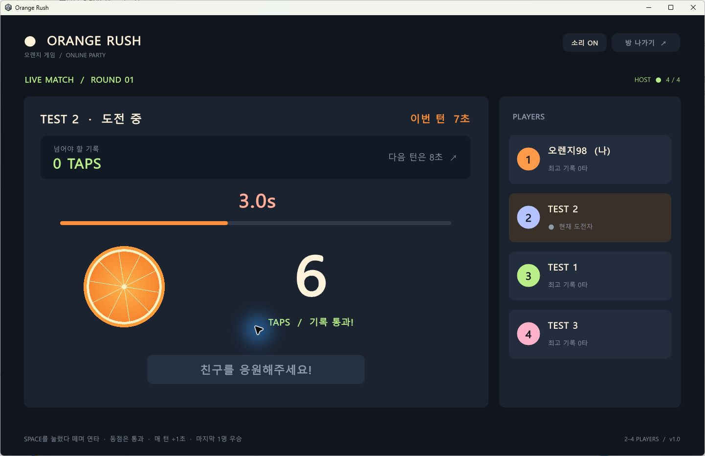

# 🍊 Orange Rush — 오렌지 러시

**7초부터 시작하는 2~4인 온라인 스페이스바 연타 게임.**

## Windows 실행판 다운로드

### [⬇ OrangeRush-Windows.zip 받기](https://github.com/SJYEOBI/orange-rush/releases/latest/download/OrangeRush-Windows.zip)

Unity 설치 없이 실행할 수 있습니다. ZIP을 **전부 압축 해제**한 뒤 `OrangeRush.exe`를 실행하세요. 실행 파일과 함께 들어 있는 폴더·DLL을 그대로 두어야 합니다.

저장소의 **Code → Download ZIP**은 개발용 소스입니다. 게임만 플레이하려면 위의 **Windows 실행판**을 받으세요. 버전별 파일은 [Releases](https://github.com/SJYEOBI/orange-rush/releases)에서 확인할 수 있습니다.

## 게임 소개

스페이스바를 두드려 기록을 세우고, 마우스로 다음 친구를 지목하세요. 직전 기록보다 적게 치면 탈락합니다. 매 턴 제한 시간이 1초씩 늘어나고, 마지막까지 살아남은 한 명이 우승합니다.



## 게임 규칙

1. 방에 2~4명이 모이면 방장이 시작합니다.
2. 룰렛으로 첫 번째 주자를 무작위 선정합니다.
3. 주자가 **준비 완료**를 누르면 3초 카운트다운 후 시작합니다.
4. 첫 턴은 **7초**, 다음 턴부터 **8초 → 9초 → 10초…**로 늘어납니다.
5. 제한 시간 동안 **스페이스바를 눌렀다 떼며 연타**합니다. 계속 누르기만 해서는 타수가 늘어나지 않습니다.
6. 직전 성공 기록 **이상이면 통과**합니다. 동점도 성공입니다.
7. 성공한 주자는 오른쪽 플레이어 카드를 마우스로 눌러 다음 주자를 지목합니다.
8. 목표보다 적게 치면 탈락하고 관전합니다. 남은 사람 중 다음 주자를 무작위 선정하며 목표 기록은 유지됩니다.
9. 마지막 한 명이 우승합니다. 방장은 **한 판 더!**로 새 게임을 시작할 수 있습니다.

첫 주자는 기준 기록을 만듭니다. 새로운 게임은 다시 7초부터 시작합니다.

## 실행 방법

### Unity에서 실행

1. **Unity 6.0 / 6000.0.59f2**로 이 저장소를 프로젝트로 엽니다.
2. `Assets/Scenes/OrangeRush.unity`를 엽니다.
3. **Play**를 누릅니다.

유료 에셋이나 별도 멀티플레이 서비스 계정은 필요하지 않습니다. 한글은 운영체제의 폰트를 사용합니다. Windows 실행판을 대상으로 제작했습니다.

### 방 만들기와 참가

- **방장:** 이름과 포트를 정한 뒤 **새 방 만들기**를 누릅니다. 기본 포트는 `7777`입니다.
- **참가자:** 방장의 주소와 같은 포트를 입력하고 **친구 방 참가하기**를 누릅니다.
- **같은 PC에서 테스트:** 실행 창을 여러 개 열고 `127.0.0.1`로 참가합니다.
- **같은 공유기:** 방장 대기실에 표시되는 내부 IPv4 주소로 참가합니다.
- **서로 다른 인터넷:** 방장 공유기의 **TCP 7777**을 방장 PC로 포트 포워딩한 뒤, 참가자는 방장 공인 IPv4 주소 또는 도메인으로 접속합니다. Windows 방화벽에서도 게임 통신을 허용해야 합니다.

IP 직접 접속 방식입니다. 자동 매칭, 방 코드, 중계 서버, 자동 NAT 통과는 포함하지 않습니다. CG-NAT나 학교·회사 망처럼 포트 개방이 불가능한 환경에서는 외부 접속이 어려울 수 있습니다.

자세한 설명은 [실행안내.txt](실행안내.txt)를 참고하세요.

## 구현

| 파일 | 역할 |
| --- | --- |
| `Assets/Scripts/GameRules.cs` | 룰렛, 턴, 시간, 타수, 지목, 탈락, 우승 판정 |
| `Assets/Scripts/NetworkRoom.cs` | 줄 단위 JSON 메시지를 주고받는 TCP 전송 |
| `Assets/Scripts/OrangeGame.cs` | 한국어 UI, 입력, 사운드, 룸 동기화 |
| `Assets/Editor/BuildGame.cs` | Windows x64 자동 빌드 |
| `Verification/` | 규칙 및 TCP 통신 검증 프로젝트 |

방장 프로그램이 서버 역할을 합니다. 룰렛, 점수, 시간 종료, 지목과 승패를 방장이 판정하고 참가자에게 상태를 전송합니다.

- 다른 사람의 타수 입력, 본인 지목, 중복 타수 패킷과 시간 종료 이후 입력을 거부합니다.
- 시간 종료는 방장에게 입력이 도착한 시각을 기준으로 판정하므로 네트워크 지연이 영향을 줄 수 있습니다.
- 도중에 연결이 끊긴 참가자는 탈락합니다. 무응답 감지는 약 15초입니다.
- 게임 중 참가·재접속과 방장 이전은 지원하지 않습니다. 방장이 종료하면 방도 종료됩니다.
- 친구끼리 즐기는 프로토타입으로, 키보드 자동 입력을 막는 기능은 없습니다.

## 검증

**.NET 9 SDK**가 있으면 Unity 없이 규칙과 TCP 통신 검사를 실행할 수 있습니다.

```sh
dotnet run --project Verification/GameRules.Tests.csproj
```

- 자동 검사 **28개 통과**: 인원 제한, 권한, 동점, 지목, 시간 증가, 마감 후 입력 거부, 탈락·우승·재시작, 실제 TCP 송수신·연결 종료.
- Windows 실행판에서 방장 1명과 같은 PC의 TCP 테스트 참가자 3명으로 4인 연결 확인.
- 룰렛, 7~10초 턴 진행, 기록 동기화, 지목, 탈락, 우승 및 대기실 복귀 확인.
- 서로 다른 외부 인터넷 회선에서의 접속은 검증하지 않았습니다.

검사 결과는 [`Verification/TestResults.txt`](Verification/TestResults.txt)와 [`Verification/IntegrationResults.txt`](Verification/IntegrationResults.txt)에 있습니다.

## Windows 빌드

Unity의 Windows Build Support가 필요합니다.

```sh
Unity.exe -batchmode -nographics -quit -projectPath "PROJECT_PATH" -executeMethod BuildGame.Build -logFile "BUILD_LOG_PATH"
```

기본 출력은 `Build/OrangeRush.exe`입니다. `ORANGE_BUILD_PATH` 환경 변수로 실행 파일 경로를 바꿀 수 있습니다. 배포할 때는 실행 파일과 함께 생성된 폴더·DLL을 모두 포함하세요.

`Library`, `Temp`, `Logs`, `UserSettings`, `Build`와 로컬 인증 파일은 Git 추적에서 제외됩니다.

