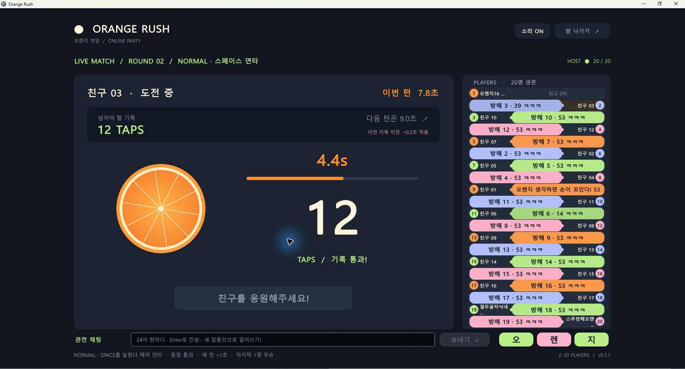
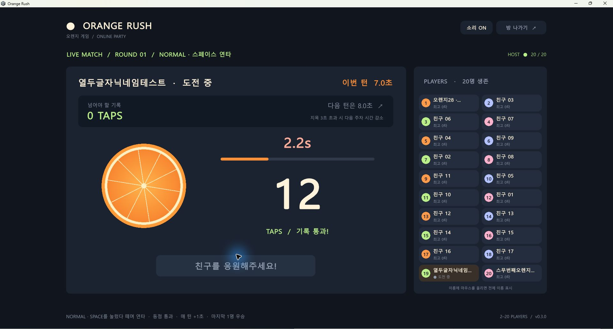
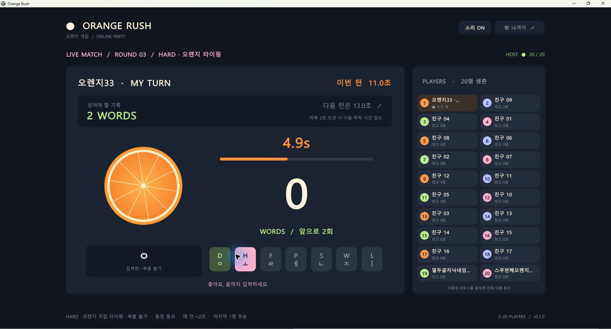

# 🍊 오렌지 러시 (Orange Rush) — 2~20인 온라인 오렌지 게임

**SJYEOBI가 만든 Windows용 2~20인 온라인 파티 게임입니다.** 스페이스바 연타와 '오렌지' 단어 타이핑으로 기록을 겨루고, 다음 플레이어를 지목하세요. 첫 턴은 7초부터 시작합니다.

## Windows 실행판 다운로드

### [⬇ OrangeRush-Windows.zip 받기](https://github.com/SJYEOBI/orange-rush/releases/latest/download/OrangeRush-Windows.zip)

Unity 설치 없이 실행할 수 있습니다. ZIP을 **전부 압축 해제**한 뒤 `OrangeRush.exe`를 실행하세요. 실행 파일과 함께 들어 있는 폴더·DLL을 그대로 두어야 합니다.

저장소의 **Code → Download ZIP**은 개발용 소스입니다. 게임만 플레이하려면 위의 **Windows 실행판**을 받으세요. 버전별 파일은 [Releases](https://github.com/SJYEOBI/orange-rush/releases)에서 확인할 수 있습니다.

## 게임 소개

로비에서 방장이 난이도를 고릅니다. 기록을 세우고 마우스로 다음 친구를 지목하세요. 직전 기록보다 적게 입력하면 탈락합니다. 첫 턴은 7초, 이후 기본은 매 턴 1초·하드는 2초씩 늘어나고 마지막까지 살아남은 한 명이 우승합니다.

| 난이도 | 입력 방식 | 점수 | 턴별 시간 |
| --- | --- | --- | --- |
| NORMAL · 기본 | 스페이스바를 눌렀다 떼며 연타 | 1회 누를 때마다 1타 | 7 → 8 → 9초… (+1초) |
| HARD · 하드 | 두벌식 자판으로 `오렌지`를 반복 입력 | 단어를 완성할 때마다 1회 | 7 → 9 → 11초… (+2초) |

하드는 `D H F P S W L`(ㅇ ㅗ ㄹ ㅔ ㄴ ㅈ ㅣ) 순서로 입력합니다. 한/영 전환이나 Enter는 필요하지 않습니다. 오타는 진행 중인 단어를 초기화하고, Backspace로 한 단계 지울 수 있습니다.

하드는 일반 텍스트 입력창을 사용하지 않습니다. 실제 글쇠의 눌림만 읽으므로 **Ctrl+V, Shift+Insert와 문자열 붙여넣기로 점수를 올릴 수 없습니다.** 서버 역시 글쇠 7개의 순서를 검증하고 완성된 단어만 셉니다. 키보드 매크로나 변조 클라이언트까지 판별하는 상용 부정행위 방지 시스템은 아닙니다.

**v0.4.2 업데이트:** 흘러가는 관전 채팅을 **22 → 26 크기, 볼드체**로 키웠습니다. 글자가 잘리거나 겹치지 않도록 표시 높이와 가로 간격도 조정했습니다. 최대 6개 동시 표시, 세 구간의 높이, 개인별 채팅 쿨타임 1.5초는 유지합니다. v0.4.1과 접속 호환됩니다.

**v0.4.1 업데이트:** 관전 채팅이 플레이 영역 중간 높이에서 **왼쪽 → 오른쪽으로 약 4~7초 동안 흐릅니다.** 중간의 세 구간 안에서 높이가 메시지마다 조금씩 달라지고, 보낸 사람 이름 없이 내용만 22 크기의 반투명 글씨로 표시합니다. 최대 6개가 동시에 흐르며 같은 구간에서는 간격을 유지해 글자끼리 겹치지 않습니다. 타이머·점수·키보드 입력 안내는 피합니다. 채팅은 **플레이어별 1.5초 간격**이며, 전송 버튼에 남은 쿨타임을 표시합니다. 프로필에는 최신 말풍선이 유지되고 소리는 기존 개인별 0.12초로 겹쳐 재생됩니다.

**v0.4.0 업데이트:** 오·렌·지 소리는 여러 사람이 동시에 눌러 겹쳐 재생할 수 있습니다. 쿨타임은 **개인별 0.12초**로 줄였으며, 같은 사람도 발음이 끝나기 전에 다시 누를 수 있습니다. 최신 관전 채팅은 **중앙 플레이 영역의 타이머 바로 위**에 큰 글씨로 강조됩니다. 프로필 말풍선도 유지하고, 새 말이 오면 기존 중앙 문구를 교체합니다.

**v0.3.1 업데이트:** 지목 지연 감점 대상을 **지목한 본인의 다음 차례**로 변경했습니다. 상대는 정상 시간을 받고, 본인 차례에서 한 번만 감점됩니다. 관전 채팅 말풍선과 오·렌·지 발음 버튼도 추가했습니다. 대기 중이거나 탈락한 참가자가 하단 입력창에 24자 한마디를 쓰고 Enter 또는 보내기를 누르면 본인 플레이어 카드에 표시됩니다. 개인별 쿨타임이 지나면 최신 한마디가 이전 프로필 말풍선을 덮어쓰고, 마지막 전송 후 8초 뒤 사라집니다. 자기 차례에는 입력창을 닫고 게임 입력으로 전환합니다. 한글 IME 채팅과 하드 점수 입력은 분리되어 있습니다.

**v0.3.0 업데이트:** 최대 20명 접속, 지목 제한시간과 다음 주자 시간 감소, 커지는 오렌지와 분리된 점수 영역을 추가했습니다. 소수점 시간과 지목 시작 시각이 동기화되도록 통신 버전을 변경했습니다. 함께 플레이하는 모든 사람이 최신 실행판으로 업데이트해야 합니다. 이전 버전과 연결하면 업데이트 안내를 표시합니다.







## 게임 규칙

1. 방장이 로비에서 기본/하드 난이도를 선택하고, 2~20명이 모이면 시작합니다. 게임 중에는 난이도를 바꿀 수 없습니다.
2. 룰렛으로 첫 번째 주자를 무작위 선정합니다.
3. 주자가 **준비 완료**를 누르면 3초 카운트다운 후 시작합니다.
4. 첫 턴은 **7초**, 다음 턴부터 기본은 **8초 → 9초 → 10초…**, 하드는 **9초 → 11초 → 13초…**로 늘어납니다.
5. 제한 시간 동안 기본은 **스페이스바 연타**, 하드는 **오렌지 직접 타이핑**으로 점수를 올립니다. 계속 누르고 있기만 해서는 횟수가 늘어나지 않습니다.
6. 직전 성공 기록 **이상이면 통과**합니다. 동점도 성공입니다.
7. 성공 결과를 3초 보여준 뒤 **지목 제한시간 3초**가 시작됩니다. 오른쪽 플레이어 카드를 마우스로 눌러 다음 주자를 지목합니다. 3초를 넘겨도 선택할 수 있지만, **초과한 온전한 1초마다 지목한 본인의 다음 차례에서 0.1초 감소**합니다. 예: A가 5초 만에 B를 지목하면 B는 정상 시간을 받고, A가 다시 도전할 때 기본 시간에서 0.2초를 뺍니다. 최소 도전 시간은 1초이며, 감점은 본인에게 한 번 적용한 뒤 초기화됩니다.
8. 목표보다 적게 치면 탈락하고 관전합니다. 남은 사람 중 다음 주자를 무작위 선정하며 목표 기록은 유지됩니다.
9. 마지막 한 명이 우승합니다. 방장은 **한 판 더!**로 대기실로 돌아가 난이도를 다시 고를 수 있습니다.

첫 주자는 기준 기록을 만듭니다. 새로운 게임은 다시 7초부터 시작합니다.

관전 채팅은 개인별 1.5초 간격으로 전송할 수 있으며, 다른 사람의 쿨타임에는 영향을 받지 않습니다. 프로필은 플레이어당 최신 말풍선 하나만 유지합니다. 흐르는 채팅의 대기 목록도 플레이어당 최신 한마디만 저장하고 오래된 말은 버립니다. 말풍선을 프로필 좌우로 번갈아 배치하고, 5~20명은 세로 목록으로 표시해 말풍선 가로 공간을 넓혔습니다. 짧은 말은 큰 글씨로, 긴 말은 칸에 맞춰 표시합니다. 채팅 내용으로 타수나 단어 점수를 올릴 수 없습니다.

채팅창 옆 **오 / 렌 / 지** 버튼을 누르면 해당 글자의 한국어 합성 발음이 방 전체에 들립니다. 쿨타임은 개인별 0.12초이며 다른 사람이 누르는 것을 막지 않습니다. 여러 사람의 소리와 같은 사람의 연속 발음이 겹쳐 재생됩니다. 자기 차례에는 관전 채팅과 발음 버튼이 비활성화됩니다.

5명 이상일 때 참가자 목록은 세로 20행 안에 배치해 20명 모두 스크롤 없이 지목할 수 있습니다. 긴 이름은 줄임 표시하고 마우스를 올리면 전체 이름을 보여줍니다. 오렌지는 기본 모드의 스페이스 입력마다, 하드 모드의 글쇠 입력마다 점점 커지고 튀어 오르며, 전용 그림 영역 안에서만 움직여 점수·타이머·하드 입력 글자를 가리지 않습니다.

## 실행 방법

### Unity에서 실행

1. **Unity 6.0 / 6000.0.59f2**로 이 저장소를 프로젝트로 엽니다.
2. `Assets/Scenes/OrangeRush.unity`를 엽니다.
3. **Play**를 누릅니다.

유료 에셋이나 별도 멀티플레이 서비스 계정은 필요하지 않습니다. 한글은 운영체제의 폰트를 사용합니다. Windows 실행판을 대상으로 제작했습니다.

### 방 만들기와 참가

- **방장:** 이름과 포트를 정한 뒤 **새 방 만들기**를 누릅니다. 기본 포트는 `7777`입니다.
- **참가자:** 방장의 주소와 같은 포트를 입력하고 **친구 방 참가하기**를 누릅니다.
- **같은 PC에서 테스트:** 실행 창을 여러 개 열고 `127.0.0.1`로 참가합니다.
- **같은 공유기:** 방장 대기실에 표시되는 내부 IPv4 주소로 참가합니다.
- **서로 다른 인터넷:** 방장 공유기의 **TCP 7777**을 방장 PC로 포트 포워딩한 뒤, 참가자는 방장 공인 IPv4 주소 또는 도메인으로 접속합니다. Windows 방화벽에서도 게임 통신을 허용해야 합니다.

IP 직접 접속 방식입니다. 자동 매칭, 방 코드, 중계 서버, 자동 NAT 통과는 포함하지 않습니다. CG-NAT나 학교·회사 망처럼 포트 개방이 불가능한 환경에서는 외부 접속이 어려울 수 있습니다.

자세한 설명은 [실행안내.txt](실행안내.txt)를 참고하세요.

## 구현

| 파일 | 역할 |
| --- | --- |
| `Assets/Scripts/GameRules.cs` | 룰렛, 턴, 시간, 타수, 지목, 탈락, 우승 판정 |
| `Assets/Scripts/NetworkRoom.cs` | 줄 단위 JSON 메시지를 주고받는 TCP 전송 |
| `Assets/Scripts/OrangeGame.cs` | 한국어 UI, 입력, 사운드, 룸 동기화 |
| `Assets/Editor/BuildGame.cs` | Windows x64 자동 빌드 |
| `Verification/` | 규칙 및 TCP 통신 검증 프로젝트 |

방장 프로그램이 서버 역할을 합니다. 룰렛, 점수, 시간 종료, 지목과 승패를 방장이 판정하고 참가자에게 상태를 전송합니다.

- 다른 사람의 타수 입력, 본인 지목, 중복 타수 패킷과 시간 종료 이후 입력을 거부합니다.
- 시간 종료는 방장에게 입력이 도착한 시각을 기준으로 판정하므로 네트워크 지연이 영향을 줄 수 있습니다.
- 도중에 연결이 끊긴 참가자는 탈락합니다. 무응답 감지는 약 15초입니다.
- 게임 중 참가·재접속과 방장 이전은 지원하지 않습니다. 방장이 종료하면 방도 종료됩니다.
- 친구끼리 즐기는 프로토타입으로, 키보드 자동 입력을 막는 기능은 없습니다.

## 검증

**.NET 9 SDK**가 있으면 Unity 없이 규칙과 TCP 통신 검사를 실행할 수 있습니다.

```sh
dotnet run --project Verification/GameRules.Tests.csproj
```

- 자동 검사 **156개 통과**: 20명 제한, 지목 유예·초과 경계, 본인 다음 차례에 한 번 적용되는 시간 감소와 최소 1초 보장, 소수점 마감 시각과 통신 직렬화, 기존 규칙, 난이도별 시간 증가, 난이도 선택 권한·게임 중 변경 금지, 단어 진행·오타·Backspace, 하드에서 스페이스 및 완성 단어 메시지 거부, 중복·마감 후 키 입력 차단, 실제 TCP 송수신·연결 종료.
- Windows 실행판에서 방장 1명과 같은 PC의 독립 TCP 테스트 참가자 19명으로 총 20인 연결 확인. 전원에게 20명 목록이 전달되고 21번째 접속은 거부됩니다.
- v0.3.1의 빠른 규칙 검사에서 상대는 정상 시간을 받고, 지목한 본인은 자기 차례에만 감점되며 감점이 한 번 적용된 뒤 초기화되는 것을 확인했습니다.
- 룰렛, 7~10초 턴 진행, 기록 동기화, 지목, 탈락, 우승 및 대기실 복귀 확인.
- 하드모드 실제 게임에서 붙여넣기 2종·스페이스는 0회 유지, 직접 `오렌지` 입력은 1회 반영을 확인.
- 서로 다른 외부 인터넷 회선에서의 접속은 검증하지 않았습니다.

검사 결과는 [`Verification/TestResults.txt`](Verification/TestResults.txt)와 [`Verification/IntegrationResults.txt`](Verification/IntegrationResults.txt)에 있습니다.

## Windows 빌드

Unity의 Windows Build Support가 필요합니다.

```sh
Unity.exe -batchmode -nographics -quit -projectPath "PROJECT_PATH" -executeMethod BuildGame.Build -logFile "BUILD_LOG_PATH"
```

기본 출력은 `Build/OrangeRush.exe`입니다. `ORANGE_BUILD_PATH` 환경 변수로 실행 파일 경로를 바꿀 수 있습니다. 배포할 때는 실행 파일과 함께 생성된 폴더·DLL을 모두 포함하세요.

`Library`, `Temp`, `Logs`, `UserSettings`, `Build`와 로컬 인증 파일은 Git 추적에서 제외됩니다.

